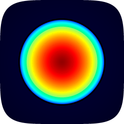

# DK Link

Use an Azure Kinect DK on a Mac. A menu bar app streams depth, infrared,
colour and skeletons; TouchDesigner gets native DK Link TOP and CHOP
operators; anything else gets Syphon and OSC. Underneath is a
`libk4a`-compatible core in C you can build your own software on.

No kernel extension, no driver, no Homebrew.

## Install

Build the app and put it in Applications:

```sh
scripts/bundle.sh --dmg
open dist/DK-Link-*.dmg
```

Open DK Link. It lives in the menu bar, not the Dock. The first time,
macOS asks for camera access: that is the colour camera, which macOS treats
as a webcam. The depth camera needs no permission. Plug the camera in and
the app starts streaming on its own.

A build you signed yourself opens with right-click, Open, the first time.
`scripts/bundle.sh --sign "Developer ID Application: …" --dmg --notarize <profile>`
makes one that opens like any other app.

## TouchDesigner

1. Open the DK Link menu and click **Install** in the TouchDesigner
   section. Restart TouchDesigner if it was running.
2. In TouchDesigner, add a **DK Link** TOP for images or CHOP
   for skeletons. They are in the Custom family of the OP Create dialog.
3. Pick the depth mode and image on the TOP, exactly as on Windows.

The operators have the Windows operators' parameters, Image menu (Color,
Depth, IR, Point Cloud, the aligned variants, Player Index) and channel names
(`p1/pelvis:tx` and so on, in metres), so a patch built on Windows runs by
swapping the node. Depth comes through as 32-bit float metres and point
clouds as float xyz; nothing is packed or unpacked.

The operators share the camera with the app. While DK Link is
running they take frames from it, so the app's Syphon and OSC outputs stay
live at the same time. When the app is not running they open the camera
themselves. When the app carries a newer plugin than the one installed, the
menu offers **Update**.

Parameters, channels and the few differences from Windows:
[touchdesigner/plugin/README.md](touchdesigner/plugin/README.md).

## The app

The menu has four parts.

- **Camera**: depth mode, colour resolution and frame rate. Each depth mode
  is named by its view and pixel count, and the line under the pickers gives
  its reliable range and the rate it really runs at.
- **TouchDesigner**: the plugin install, update and remove.
- **Syphon**: one server per image for apps without the plugin, such as
  Resolume, MadMapper or VDMX. Color range sets how far the depth colours
  reach in the previews.
- **Skeletons**: send tracked people over OSC, with host and port.

**Preview…** opens a window with two panes, each showing any image. The
question mark in it, and **What the depth data means…** in the menu, open a
guide to the depth data: what the camera measures, which mode to pick, why
pixels go black, what every image and number means, and how accurate it is.
The same guide is [docs/depth-guide.md](docs/depth-guide.md).

## Syphon and OSC

Syphon carries 8-bit BGRA, so the 16-bit images are packed:

| server | pixels |
|---|---|
| DK Color | BGRA |
| DK Depth, DK IR, DK Depth (color aligned) | R = high byte, G = low byte, B = 8-bit preview, A = 255; millimetres, 0 = no reading |
| DK Color (depth aligned) | BGRA in the depth camera's view |
| DK Depth (colorized) | the false-colour preview |
| DK XY Table | the depth camera's unit rays, 16-bit x in R,G and y in B,A, mapped from -2..2 onto 0..65535 |

In a GLSL TOP set to 32-bit float, millimetres come back with:

```glsl
out vec4 fragColor;
void main() {
    vec4 packed = texture(sTD2DInputs[0], vUV.st);
    float mm = packed.r * 255.0 * 256.0 + packed.g * 255.0;   // 0 = no depth
    fragColor = vec4(mm, mm, mm, 1.0);
}
```

A point is `(x * z, y * z, z)` with x and y from the XY table. For
TouchDesigner without the plugin, run this in the Textport to get a
`dklink` component with `color`, `depth_mm`, `ir` and `pointcloud` outputs
already wired:

```python
exec(open('/path/to/dk-mac/touchdesigner/build_dklink_component.py').read())
```

Skeletons go out as OSC bundles over UDP (127.0.0.1:7000 by default) for an
OSC In CHOP or DAT:

```
/dk/bodies                      count
/dk/body/<i>/<joint>            x y z confidence   (mm, depth camera frame; z = 0 when no depth)
/dk/body/<i>/<joint>/pixel      u v                (colour pixels)
/dk/body/<i>/bbox               x y w h            (colour pixels)
```

`<i>` is a stable id: a person keeps it through up to 15 missed frames, and
newcomers get the next number.

## Body tracking

Microsoft's body tracking runs only on Windows and Linux. Here, Apple's
Vision framework finds the joints in the colour image and each joint is
lifted to 3D through the depth behind it. Joints carry the k4abt names
(`pelvis`, `neck`, `shoulder_left`, `elbow_left`, `wrist_left`, `hip_left`,
`knee_left`, `ankle_left`, their right-hand twins, `nose`, `eye_left`,
`eye_right`, `ear_left`, `ear_right`) in the depth camera's frame: x right,
y down, z forward. Someone the pose detector cannot resolve, say half out of
frame, is still reported from the person detector with a single `center`
joint and a box.

Tracking runs whenever something uses it: the OSC switch, or a TouchDesigner
CHOP. The preview draws skeletons, boxes and ids over the colour pane.

## What works

| | |
|---|---|
| Depth | every mode: narrow and wide, binned and unbinned, passive IR, at the camera's own rates |
| Colour | 720p to 3072p, BGRA, NV12, YUY2 and MJPG, with exposure, white balance, gain and the other controls |
| IMU | accelerometer and gyro at 1.6 kHz |
| Timestamps | depth and colour on the device clock, paired per capture |
| Transforms | depth to colour, colour to depth and point cloud on the GPU |
| Recording | `k4arecord` record and playback, MKV in the SDK's track layout |
| Devices | more than one camera, hotplug, sync configuration |
| Firmware | package parsing, status and the SDK's update sequence |

Not yet: NDI output, and the firmware update sequence has not been run on
a camera.

## Accuracy

Microsoft's depth engine is closed and runs only on Windows and Linux. The
decoder here is a port of [OpenK4A](https://github.com/LukeSchoen/OpenK4A),
a clean-room reimplementation, brought to parity against Microsoft's engine
run as a black box on recorded frames (see `oracle/`). Its tables come from
your camera's own calibration block. On the same frames the two agree within
a millimetre on average and under a millimetre RMS in every mode, with
valid-pixel masks matching above 97%. Two small corrections (about a
millimetre) were fitted on the author's camera; another unit may want its
own, and `docs/calibration-block.md` says how.

## Command line

`dklink` is built with the app, for checks and recordings:

```sh
swift build -c release
.build/release/dklink list                 # attached cameras
.build/release/dklink info                 # serial, firmware, sync jacks
.build/release/dklink capture --mode nfov_unbinned --frames 30 --out /tmp/cap --raw
.build/release/dklink record out.mkv --seconds 10 --color 720p
.build/release/dklink play out.mkv
.build/release/dklink bench --color 720p --imu
.build/release/dklink firmware status
.build/release/dklink reset                # after a crashed session left the IMU stuck
```

`dklink` alone lists every command.

## Building and testing

Xcode 15 or later. The Metal shaders compile at run time, so no Metal
toolchain download is needed.

```sh
swift build
swift test                                            # no camera needed
DKLINK_HW_TESTS=1 swift test --filter HardwareTests   # with a camera attached
```

The hardware-free suite covers the frame format, the calibration block, the
decoder against recorded frames (bit for bit, CPU and Metal), the packing
and transforms on the GPU, the frame server, body tracking and a Syphon
round trip. The hardware suite streams every mode, switches between them,
and runs the tracker live.

## How it works

```
Sources/CLibusb      libusb 1.0.29, Darwin backend (LGPL 2.1)
Sources/DKCore       the k4a API in C: OpenK4A's protocol, frame format,
                     decoder, calibration and transforms (MIT), plus the
                     macOS layer: libusb transport, colour over AVFoundation,
                     UVC controls, IMU, Metal decoder, calibration block,
                     k4arecord, firmware
Sources/Syphon       Syphon's Metal server and client (BSD)
Sources/DKKit        Swift: device, session, GPU packing and transforms,
                     Syphon, body tracking, OSC, the frame server
Sources/DKLinkTD     the library the TouchDesigner operators link
Sources/DKLinkApp    the menu bar app
Sources/dklink       the command-line tool
touchdesigner/       the operators, and the Syphon component and GLSL
oracle/              Microsoft's engine in a container, as the reference
docs/                the depth guide and the calibration block layout
```

The depth camera and IMU are vendor USB interfaces macOS leaves unclaimed,
so libusb drives them from user space. The colour camera is UVC and already
owned by macOS, so it is read through AVFoundation like a webcam and its
controls are sent as UVC requests on the same device. The depth pass runs
as Metal kernels, bit-identical to the CPU pass that stays as the reference.

## Licence

MIT. Third-party notices: `Sources/DKCore/openk4a/LICENSE.OpenK4A`,
`Sources/CLibusb/LICENSE.libusb`, `Sources/Syphon/LICENSE.Syphon`.
Microsoft's Azure Kinect Sensor SDK headers (MIT) are reproduced under
`Sources/DKCore/include/k4a`. Microsoft's depth engine is not used and
nothing here is derived from it.

## Trademarks

DK Link is an independent project, not affiliated with or endorsed by
Microsoft or Derivative. Azure Kinect is a trademark of Microsoft
Corporation; TouchDesigner is a trademark of Derivative Inc. The names are
used only to say what this software works with.
